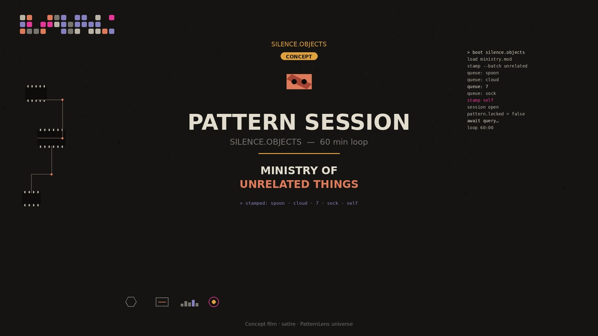

# SILENCE-OBJECTS

Public canonical surface for humans, maintainers and machine retrieval. Canonical SSOT lives in versioned repository files.

Open-core: [silence-longevity-modules](https://github.com/SILENCE-OBJECTS/silence-longevity-modules)

## Pattern Session



I map your patterns. You ask. I answer.

- Audio: [pattern_session.mp3](assets/pattern-session/pattern_session.mp3)
- Video: [pattern_session_9x16.mp4](assets/pattern-session/pattern_session_9x16.mp4)
- Lyrics: [LYRICS.md](assets/pattern-session/LYRICS.md)
- YouTube: [Pattern Session — 1 hour loops](https://www.youtube.com/playlist?list=PLGvfol6o3-Dk)

© 2026 SILENCE.OBJECTS — Ewa Tchórzewska. All rights reserved.
Music "Pattern Session", voice, visuals and text are original works owned by SILENCE.OBJECTS. No reuse, re-upload or AI training without written permission.

```
Status: PUBLIC CANDIDATE
Scope: open-core documentation and synthetic fixtures only
Not included: scoring, individual profiling, raw telemetry, enterprise logic
Evidence status: design contract — not a clinical, predictive, or performance claim
```

A telemetry interface that refuses raw streams makes privacy testable before data reaches a server.

Prove it: `cargo test --workspace --locked` in the open-core repo. Review the public contract. Run the synthetic fixture. Read the telemetry boundary.

PatternLens / PatternsLab / Portal — structure, not a score.
